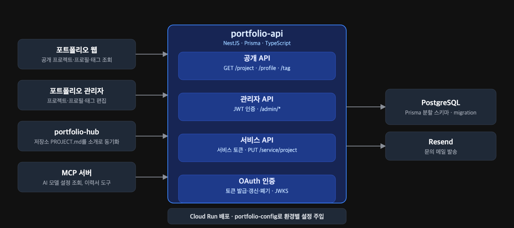
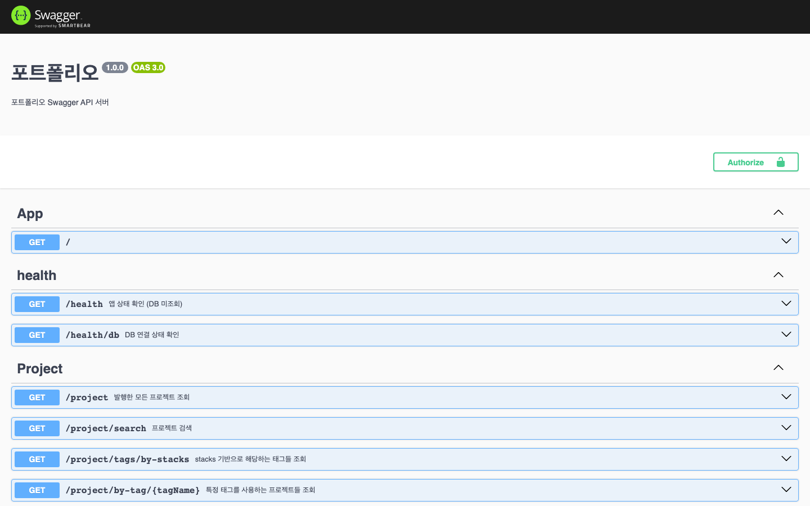
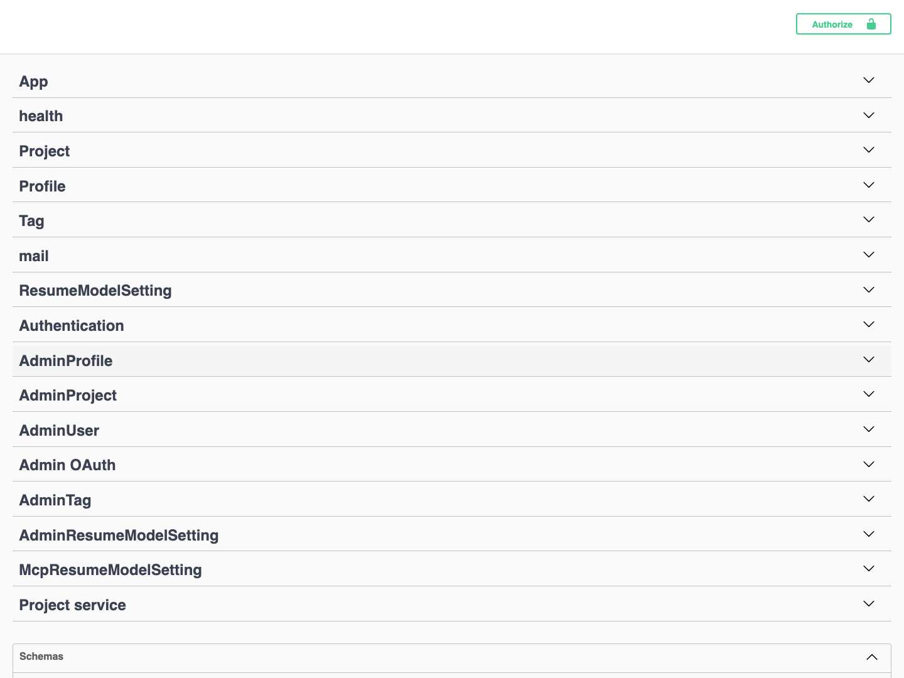
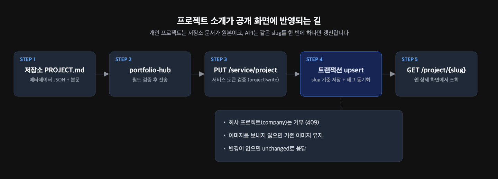
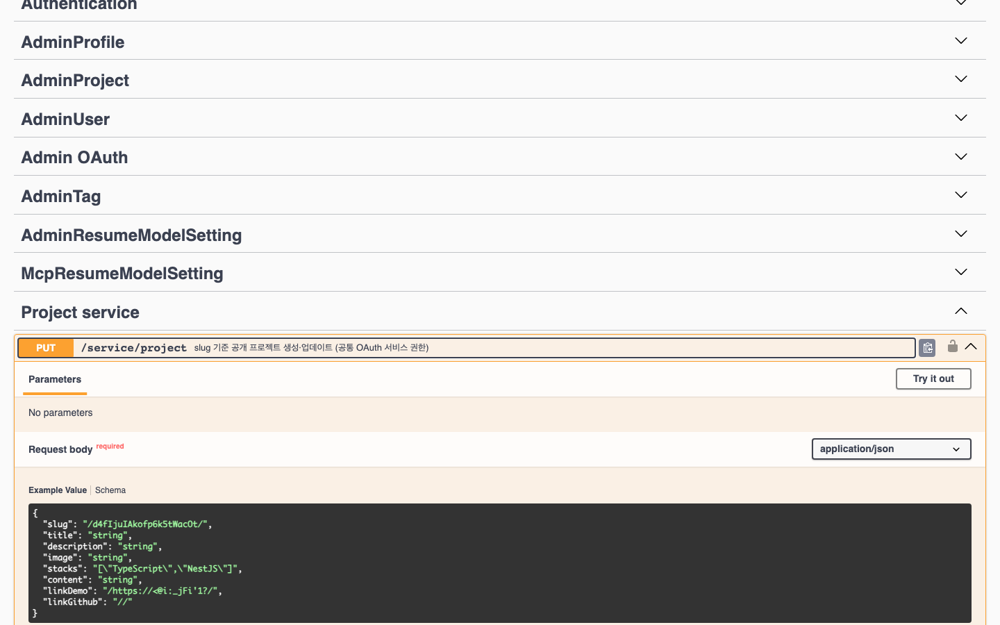

```json
{
  "schemaVersion": 1,
  "slug": "portfolio-api",
  "title": "포트폴리오 API",
  "description": "포트폴리오 웹과 관리자 화면이 함께 쓰는 NestJS 백엔드입니다. 프로젝트·프로필·기술 태그를 저장해 공개 조회와 관리자 편집으로 나눠 제공하고, 저장소의 PROJECT.md로 프로젝트 소개를 갱신하는 서비스 API와 OAuth 인증을 갖췄습니다.",
  "image": "https://raw.githubusercontent.com/side-projects-labs/portfolio-api/b33798e299eab071e81770ee76170711a7fff91c/PROJECT.png",
  "stacks": [
    "TypeScript",
    "Prisma",
    "PostgreSQL",
    "Node.js",
    "Jest",
    "GitHub Actions"
  ],
  "linkDemo": "https://api.ycseng.com/api",
  "linkGithub": "https://github.com/side-projects-labs/portfolio-api"
}
```

# 포트폴리오 API

## 목차

- [화면 뒤에서 데이터를 맡는 서버](#화면-뒤에서-데이터를-맡는-서버)
- [한눈에 보는 API 구성](#한눈에-보는-api-구성)
- [공개 조회와 관리자 편집](#공개-조회와-관리자-편집)
- [저장소 문서로 소개를 갱신하는 서비스 API](#저장소-문서로-소개를-갱신하는-서비스-api)
- [OAuth 인증과 이력서 모델 설정](#oauth-인증과-이력서-모델-설정)
- [구조와 운영](#구조와-운영)
- [마치며](#마치며)

포트폴리오 사이트를 만들고 나니 화면에 보여 줄 데이터를 어디에 둘지가 다음 문제였습니다. 프로젝트 소개를 코드에 넣어 두면 내용을 고칠 때마다 사이트를 다시 배포해야 합니다. 그래서 데이터와 화면을 나누고 데이터를 맡는 서버를 따로 만들었습니다. 이 프로젝트가 그 서버인 포트폴리오 API입니다.

## 화면 뒤에서 데이터를 맡는 서버

서버가 맡는 데이터는 크게 네 가지입니다.

- **프로젝트**: 제목, 요약, 대표 이미지, 링크, 마크다운 본문과 노출 순서를 저장합니다.
- **프로필**: 이름과 이미지로 구성한 프로필을 여러 개 두고 공개 조회는 활성 프로필만 돌려줍니다.
- **기술 태그**: 프로젝트에 붙는 기술 이름과 아이콘·색상·분류 정보입니다.
- **이력서 모델 설정**: 이력서 초안을 만드는 AI 모델의 공급자와 키를 관리합니다.

이 데이터를 쓰는 쪽도 넷으로 나뉩니다. 방문자가 보는 포트폴리오 웹은 읽기만 하고 관리자 화면은 편집을 맡습니다. 저장소의 PROJECT.md를 소개로 옮기는 portfolio-hub와 이력서 도구를 제공하는 MCP 서버는 각자 필요한 권한으로 서버를 호출합니다. 호출하는 쪽마다 허용할 범위가 다르므로 API도 그에 맞춰 구역을 나눴습니다.



_호출하는 쪽에 따라 공개·관리자·서비스·인증 구역을 나누고, 데이터는 PostgreSQL에 Prisma로 저장합니다._

## 한눈에 보는 API 구성

API 문서는 Swagger UI로 공개해 두었습니다. 접속하면 제목 아래에 인증 입력 버튼이 있고 구역별 엔드포인트가 목록으로 이어집니다. 문서는 코드의 데코레이터에서 만들어지므로 엔드포인트가 바뀌면 문서도 함께 바뀝니다. 현재 구역은 16개이고 엔드포인트는 67개입니다.



_운영 서버의 Swagger 화면입니다. 공개 조회 엔드포인트마다 한 줄 설명이 붙어 있습니다._

구역 이름만 보아도 호출하는 쪽을 알 수 있습니다. `Project`, `Profile`, `Tag`는 누구나 읽는 공개 조회이고 `Admin`으로 시작하는 구역은 관리자 편집입니다. `McpResumeModelSetting`과 `Project service`는 서비스 연동용이며 `Authentication`은 OAuth 인증을 맡습니다.



_16개 구역을 접어 둔 모습입니다. 이름의 접두어로 공개, 관리자, 서비스 연동을 구분합니다._

## 공개 조회와 관리자 편집

### 방문자가 읽는 데이터

공개 구역은 로그인 없이 읽습니다. 프로젝트는 목록, 검색, 슬러그 단건, 태그별, 기술 스택별 조회를 제공하고 게시된 프로젝트만 돌려줍니다. 응답에는 최근 7일 안에 갱신된 프로젝트를 알려 주는 `isRecent` 값이 붙어서 웹이 "새로 올라온" 표시를 따로 계산하지 않아도 됩니다. 태그 구역에는 태그마다 연결된 프로젝트 수를 세어 주는 통계 조회가 있고 포트폴리오 웹의 태그 화면이 이 값을 씁니다. 문의 메일은 `POST /mail/send`로 받아 Resend로 발송합니다.

### 관리자가 편집하는 데이터

관리자 구역은 프로젝트, 프로필, 태그의 생성·수정·삭제와 노출 순서 변경, 게시 전환을 제공합니다. 슬러그 중복을 미리 확인하는 조회도 있어서 입력 화면에서 저장 전에 알려 줄 수 있습니다. 관리자 로그인은 이메일과 비밀번호 방식(가입, 로그인, 비밀번호 재설정)과 Google·GitHub OAuth 방식이 함께 있으며 인증을 통과한 요청만 JWT 가드를 지납니다.

프로젝트에는 출처 구분이 있습니다. `personal`은 저장소 문서로 동기화하는 개인 프로젝트이고 `company`는 직접 관리하는 회사 프로젝트입니다. 개인 프로젝트는 관리자 구역에서 내용을 수정할 수 없고 수정 요청에 충돌(409)로 응답합니다. 원본이 저장소 문서 하나이므로 관리자 화면에서 고친 내용이 다음 동기화에 덮이는 일을 막기 위한 규칙입니다. 출처 자체도 수정할 수 없습니다.

## 저장소 문서로 소개를 갱신하는 서비스 API

개인 프로젝트의 소개는 각 저장소 루트의 PROJECT.md가 원본입니다. portfolio-hub가 이 문서의 메타데이터와 본문을 읽어 `PUT /service/project`로 보내면 API가 슬러그를 기준으로 프로젝트를 만들거나 갱신합니다.



_저장소 문서에서 공개 조회까지의 흐름입니다. 저장 단계에서 회사 프로젝트 거부와 변경 없음 판정이 일어납니다._

이 엔드포인트는 입력과 호출자를 모두 엄격하게 확인합니다.

- **호출자 확인**: GitHub Actions가 발급한 OIDC 토큰을 검증하고 토큰 교환(RFC 8693)으로 15분짜리 서비스 토큰을 받습니다. 서비스 구역은 이 토큰의 범위가 `project:write`인지, 발급 대상 서버와 상태, 폐기 여부, 만료 시각이 인증 이력과 일치하는지 확인합니다.
- **입력 검증**: 정의하지 않은 필드가 하나라도 들어오면 400으로 거절합니다. 응답에는 `Cache-Control: no-store`를 붙입니다.
- **저장 방식**: 한 트랜잭션 안에서 프로젝트를 저장하고 스택 이름대로 태그를 맞춥니다. 없는 태그는 새로 만들고 빠진 태그는 연결을 지웁니다. 격리 수준은 Serializable이며 충돌이 나면 최대 세 번까지 다시 시도합니다.
- **변경 판정**: 저장할 내용이 기존 값과 같으면 쓰지 않고 `unchanged`로 응답합니다. 결과는 `created`, `updated`, `unchanged` 중 하나입니다.
- **보호 규칙**: 회사 프로젝트는 자동 동기화를 거부합니다. 이미지를 보내지 않으면 기존 대표 이미지를 유지하고 새 프로젝트는 즉시 게시 상태로 만듭니다.



_서비스 연동 구역의 프로젝트 저장 엔드포인트입니다. 자물쇠 표시가 인증이 필요한 엔드포인트임을 알려 줍니다._

## OAuth 인증과 이력서 모델 설정

### OAuth 인증 서버

MCP 서버와 서비스 연동이 쓰는 OAuth 인증 구역은 직접 구현했습니다. 인가 코드 흐름은 PKCE(S256)를 지원하고 토큰은 RS256으로 서명해 공개 키를 JWKS 주소로 내보냅니다. 서버 메타데이터는 `.well-known` 경로에서 읽을 수 있습니다. 액세스 토큰은 1시간, 리프레시 토큰은 30일, 인증 state는 10분 동안 유효하며 발급·갱신·폐기와 토큰 확인(introspect)을 각각 엔드포인트로 제공합니다. 발급한 토큰은 이력 테이블에 기록해 폐기와 만료를 서버에서 판정합니다. 사용자 신원은 GitHub 계정과 연결해 저장합니다.

### 이력서 모델 설정

이력서 초안을 쓰는 AI 모델의 설정은 이 서버가 소유합니다. 공급자는 OpenRouter, OpenAI, Gemini 세 가지이고 모델 이름과 호출 주소, 키를 환경별(개발·운영)로 저장합니다. 환경마다 활성 설정은 하나만 허용하며 이 규칙은 코드가 아니라 마이그레이션의 부분 유니크 인덱스가 강제합니다. 공급자마다 허용하는 호스트가 정해져 있어서 다른 공급자 주소나 HTTP, 사용자 정보가 든 주소는 저장할 수 없습니다. 이 서버는 모델을 직접 호출하지 않고 설정만 보관합니다. 키는 MCP 서버가 보호된 조회로 받아 요청마다 사용하며 정적 환경변수나 별도 비밀 저장소 참조로 두지 않습니다.

## 구조와 운영

### 폴더 구조

코드는 호출하는 쪽을 기준으로 나눴습니다.

```text
src/
├── apps/
│   ├── public/     공개 조회, 메일, 인증·OAuth
│   ├── admin/      관리자 API(JWT), 관리자 로그인과 OAuth
│   ├── service/    서비스 토큰으로 호출하는 프로젝트 동기화
│   ├── mcp/        MCP용 이력서 모델 설정
│   └── identity/   사용자 신원과 OAuth state
├── health/         앱·DB 상태 확인
├── prisma/         PrismaService
└── main.ts         진입점, CORS, Swagger
```

도메인마다 `controller`, `service`, `module`과 요청·응답 DTO를 한 폴더에 두고 `dto/index.ts`로 내보냅니다. DTO 이름은 `<구역><도메인><동작>Request|Response` 형식이고 검증은 class-validator, 문서화는 `@nestjs/swagger` 데코레이터가 맡습니다.

### 데이터베이스와 마이그레이션

Prisma 스키마는 `prisma/models/*.prisma`로 나눠 관리하고 병합 스크립트로 `schema.prisma`를 만듭니다. 병합 산출물은 직접 고치지 않으며 스키마를 바꿀 때는 migration SQL을 함께 커밋합니다. 현재 마이그레이션은 18개입니다. 프로필 추가에서 시작해 프로젝트·태그 관계, 이력서 모델 설정, 공통 사용자 신원과 토큰 수명 주기, MCP OAuth, 모델 공급자 추가, 프로젝트 출처 추가 순서로 쌓였습니다. 적용 이력은 Prisma가 기록하는 `_prisma_migrations`만 쓰고 수동으로 반영한 변경은 `migrate resolve`로 정합화합니다.

### 상태 확인과 배포

`/health`는 DB를 조회하지 않고 앱이 떠 있는지만 알려 줍니다. `/health/db`는 DB 연결 상태와 응답 지연을 돌려줍니다. GitHub Actions가 매시간 `/health/db`를 호출해 실패하면 요약에 기록합니다. 배포는 `master`에 푸시하면 GitHub Actions가 컨테이너 이미지를 빌드해 Cloud Run에 올리는 흐름입니다. 환경별 설정은 이미지에 포함한 portfolio-config CLI로 받아 서버를 시작합니다. CORS는 포트폴리오 웹과 관리자 화면, 로컬 개발 주소만 허용합니다.

### 테스트와 검증

단위 테스트와 e2e 테스트 파일이 52개 있습니다. e2e는 앱 기동, 통합, 프로젝트 서비스, 이력서 모델 설정 시나리오를 다루며 통합 테스트는 별도 스크립트로 실행합니다. PR마다 CI가 린트, 포맷, 타입 검사, 커버리지 테스트를 돌립니다. 이 저장소에도 AI 에이전트가 따를 작업 규칙을 두어 테스트를 먼저 쓰고 커밋과 PR 절차를 지키게 합니다.

## 마치며

포트폴리오 API는 화면에 필요한 데이터를 한곳에 모아 두는 서버입니다. 공개 조회와 관리자 편집, 서비스 연동, 인증을 구역으로 나눠 호출하는 쪽마다 알맞은 권한을 줬고 Swagger 문서로 그 경계를 공개했습니다.

저장소 문서로 소개를 갱신하는 길에 가장 공을 들였습니다. PROJECT.md를 고치면 서비스 토큰 검증, 트랜잭션 저장, 공개 조회를 거쳐 사이트의 프로젝트 상세 화면에 반영됩니다. 이 문서도 같은 길을 지나 이 서버에 저장됩니다.
